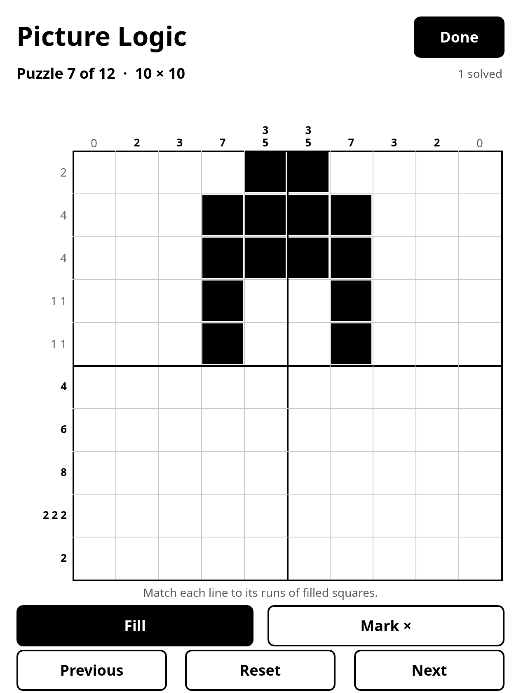

# Picture Logic

Picture Logic reveals small pixel pictures through number clues. It includes twelve original puzzles for PrimitiveOS, with six 5 × 5 boards and six 10 × 10 boards.



Each clue gives the lengths of the filled runs in its row or column, in order. Leave at least one empty square between runs. Choose **Fill** to ink squares or **Mark ×** to rule them out. Tap a square again with the same tool to clear it. A clue becomes muted when the line's filled runs match it.

Finish any puzzle to reveal its picture and name. Use **Previous** and **Next** to move between puzzles. Each page keeps its own progress. **Reset** clears the current page after confirmation.

## Install

Open **Store** from Primitive Launcher, search for **Picture Logic**, and install it. See the [installation guide](INSTALL.md) for local testing.

## Desktop preview

From this repository, with the shared Tools and Launcher repositories beside it, run:

```sh
cargo test --locked --workspace
cargo run --locked -p picturelogic-desktop -- docs/images
```

The preview runs through a 5 × 5 solve and captures the board in dark mode. [Solved preview](docs/images/picturelogic-solved.png)

## Licence

The code is licensed under [PolyForm Noncommercial 1.0.0](LICENSE). Documentation and artwork are licensed under [CC BY-NC-SA 4.0](LICENSE-DOCS).
