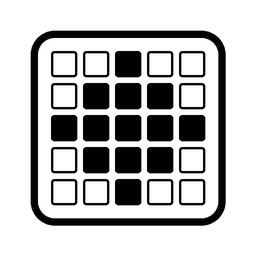

# Nonogram

**Reveal a picture from number clues**

  

[**Download**](https://github.com/PrimitiveOS/kindle-primitive-nonogram/releases/latest) · [**Install guide**](INSTALL.md) · [**Changelog**](CHANGELOG.md)

---

Read the clues along each row and column, then fill the matching squares to reveal a picture. Play original 5×5 and 10×10 puzzles offline and resume any puzzle where you left off.

## Quick start

After setting up PrimitiveOS, open **Store** from Primitive Launcher. Choose **Nonogram** under **Apps**,
tap **Get**, and open it from the Launcher grid. The [install guide](INSTALL.md) also covers the standalone USB package.

## Highlights

- Read the clues along each row and column, then fill the matching squares to reveal a picture.
- Play original 5×5 and 10×10 puzzles offline and resume any puzzle where you left off.

## Status

| Device | Status |
|---|---|
| Kindle Oasis 3 (1264 × 1680, firmware 5.18.2) | Tested on hardware |

**Current version: 0.1.2.** Changes are in [CHANGELOG.md](CHANGELOG.md).

## Downloads

The badge at the top shows the number of Store downloads. It counts GitHub downloads of this app's release packages, across all versions and architectures, and is refreshed daily from the [Store catalog](https://primitiveos.github.io/kindle-primitive-catalog/v1/index.json).

## Documentation

[Install guide](INSTALL.md) · [Changelog](CHANGELOG.md)

## Licence

The code is licensed under [PolyForm Noncommercial 1.0.0](LICENSE). Documentation and artwork are licensed under [CC BY-NC-SA 4.0](LICENSE-DOCS).
